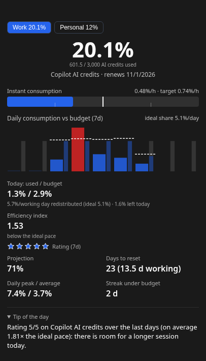

🌐 **English** | [Italiano](README.it.md)

# IA Hypermiler

A small always-on-top widget for Windows, macOS and Linux that tells you how fast you are using your **Claude**, **GitHub Copilot** and **Codex** (ChatGPT subscription) quotas, and how much you can still use today so the quota lasts until it renews.

> **Claude quotas are not available in this version.** Anthropic does not allow third-party apps to sign in to claude.ai or to store its session ([Claude Code legal and compliance](https://code.claude.com/docs/en/legal-and-compliance)), which was the only way this app could read them. A Claude account now shows only the local insights from Claude Code. The quotas will return through an allowed source ([#139](https://github.com/suppressio/ia-hypermiler/issues/139)).

Example data, not a real account.

- **Several accounts**, any mix of Copilot and Codex (e.g. a personal Codex account and a company Copilot seat), each with its own session; a Claude account carries the local insights.
- **Your working days**: each account can follow its own schedule (full, half or day off per day of the week), so weekends do not count as time you could have spent the quota.
- **A budget for today**, recomputed every morning from what is left.
- **Notifications** when a quota passes your alert threshold, or when today's use goes well over today's budget.
- English and Italian interface.

> Personal project in active development (`v0.x-beta`).

---

## Install

Open the **[latest release](https://github.com/suppressio/ia-hypermiler/releases/latest)** and download, under *Assets*, the file for your system:

| System | File |
|---|---|
| Windows | `ia-hypermiler-Setup-<version>.exe` |
| macOS (Apple Silicon) | `ia-hypermiler-<version>-arm64.dmg` |
| Linux, any distribution | `ia-hypermiler-<version>.AppImage` |
| Debian, Ubuntu | `ia-hypermiler_<version>_amd64.deb` |

Other versions, including pre-releases for testing, are on the [Releases](https://github.com/suppressio/ia-hypermiler/releases) page.

The packages are not signed: Windows SmartScreen and macOS Gatekeeper show a warning the first time. The app checks for new versions at startup and every 24 hours and opens the right download in your browser.

## First start

1. Open **Settings** (⚙ in the widget, or from the tray icon) → **Add account**.
2. **Claude**: no login. Add the account only for the local insights (see below); its quotas are not available in this version.
   **Codex (ChatGPT)**: add an account with this provider, click *Connect…* and sign in in the chatgpt.com window, which closes by itself. No Codex CLI or IDE extension is needed; only usage is read. *Disconnect* clears the session.
   **GitHub Copilot**: paste a Personal Access Token (fine-grained, *Plan* read-only, or classic with no scope), or sign in with a GitHub OAuth App. For a company seat on a `<name>.ghe.com` tenant, set the GitHub domain first.
3. Optional, per account: the **work schedule** (last section of the account) and, only when the provider does not report it, the **renewal day**.

The tray badge shows one account and limit window as a coloured number (green, orange, red like the widget, grey when stale; on macOS, text beside the icon). Choose **Off**, **Auto**, or an **account · window** in the tray menu or Settings → Appearance. Auto follows the critical window of the last account whose usage increased, stays there while idle, and starts with the highest utilization. It leaves the panel on the view you are reading. Clicking a panel account tab or window selects Manual (with the badge Off it only changes the panel): panel and tray then show the same view, including when you choose it from the tray. If a Manual account is disabled or its window disappears, its checked entry is disabled and Auto is shown temporarily; the preference returns when available. With **Critical alerts** enabled (default), another view at or above the notification threshold alternates with the normal badge every 2 seconds in red (`!95`, or `100`; macOS `!95%`), independently of window animations. Off also disables alerts. The tooltip lists every account. Closing the widget leaves the app in the tray; *Quit* is in its menu.

---

## Reading the widget

All the values below are about the quota window shown, usually the one needing attention most. With several accounts there is one tab per account; with several quota windows (e.g. Claude's 5-hour and weekly limits) a list above the main value shows each one with a short verdict. Click a row to see that window.

Codex shows the **5-hour limit** and **Weekly limit**, both rolling. As with the other rolling windows, the 5-hour limit reads in hours: time to reset, projection at reset and autonomy at the current pace, with daily indicators hidden. The weekly limit reads per working day. Other windows, such as code review, appear with their own label only if ChatGPT reports them.

### Compact view

The triangle in the title bar (between minimize and close) shrinks the widget to just the percentage and the instant consumption bar of the window it opens on; the window is then fixed in size. Click it again to get the full view back, at its previous size and position. The choice is remembered across restarts.

### The verdict on each window

From the quota left **now**, spread over the working days until the reset, compared with an even split of the whole period:

| Verdict | Meaning |
|---|---|
| **on track** | within ±5% of the even split |
| **room to spare** | you have used less than planned: more per day is available |
| **quota reduced** | you have used more than planned: less per day is left |
| **at risk** | less than half the even split is left per day, or your current pace would run out before the reset |

### Main value

Percentage of the quota used, and below it the absolute value when the provider gives one (e.g. Copilot AI credits, Claude extra credit in USD) and the renewal date.

### Instant consumption

How fast you are using the quota right now, in % of the quota per hour.

- **How it is computed**: the rise in usage over about the last hour of readings. While usage is rising the app reads the provider every 5 minutes, otherwise at the interval set in Settings (30 minutes by default).
- **Target** (the white marker): the pace that would bring you exactly to 100% at the reset, spread over the working hours left.
- **How to read it**: the marker is always in the middle. The faint ticks mark half the target (left) and twice the target (right), and the far right end is four times the target or more. The bar turns red above the target. A short burst is fine; a bar that stays red for hours is what to watch.
- **Background arrows**: `>>>` means you can consume more, `<<<` means slow down. They compare the last-hour average with the target and disappear within ±15% or while waiting for samples. A larger gap makes them flow faster, up to a limit. Right arrows appear only on the account’s full/half working days (the schedule has no start/end times); a disabled schedule has no day restriction. Left arrows also appear on days off.

### Daily consumption vs budget

One slot per day: the last 7 or 30 days (Settings → Chart range), then the next 2 or 5 days. Today is the slot with a light background.

- **Wide bar**: what you used that day. Red when it went over that day's budget.
- **Thin bar beside it**: the even split of a full working day. The coloured part is that day's working share (all of it, half on a half day); the grey part is the share the day does not get (all of it on a day off).
- **Dashed line**, the part that moves:
  - on a past day, the budget you had **that morning**;
  - today, **today's budget**;
  - on the days to come, what is left **redistributed** over the working days until the reset.

  A heavy day lowers the line of the days after it; a light day raises it.
- **Ideal share** (top right): the even split of a full working day for the whole period.

### Today: used / budget

What you have used today against **today's budget**: what was left this morning, divided by the working days until the reset (today included), times today's share (half on a half day). It stays fixed for the day.

Below it: the quota left per working day from now on, next to the ideal one, and what is left today or how far over you are.

### Efficiency index and rating

- **Efficiency index**: the ideal pace divided by your actual pace since the start of the period, on working days. Above 1 you are using less than the ideal pace, below 1 more.
- **Stars** (over the chart range): how consistently each day stayed close to its ideal share. 5 stars: on average you used two thirds of the share or less; 3 stars: about the share; 1 star: well over it.

### Projection

Where usage would be at the reset if you keep going like this: half the average pace of the period, half the pace of the last three completed working days. It can go over 100%: that is the point.

### Days to reset

Calendar days until the reset, and in brackets the working days according to the account's schedule.

### Estimated autonomy

How many working days the quota lasts at the current pace. **Shown only when it runs out before the reset**: otherwise it would only repeat the projection.

### Daily peak / average

Your heaviest day and your average day among the completed days of the chart range. Shown from two completed days on.

### Streak under budget

Consecutive completed days, up to yesterday, that stayed within their budget: the same days that are not red in the chart. Days off with no use are skipped. Hidden while it is 0.

### Tip of the day

Shown only when it adds something the numbers above do not say: you would run out before the reset (and by how much to slow down), a good rating that leaves room for a longer session, a quota almost used up close to the reset, or (with local insights) a link between your heaviest days and very long contexts.

### Colours

- **Main value and projection** turn **orange** 5 points below your alert threshold and **red** from the threshold on (Settings → Notifications, 80% by default).
- **Today: used / budget** turns **orange** once you have used the alert threshold of today's budget (80% of it by default) and **red** only when you go over it.
- **Chart bars** are red when that day went over its budget (the dashed line).

### Local insights (Claude Code, optional)

When enabled on one Claude account, the app reads the Claude Code sessions on this computer (token counts and tool names only, never the content of your messages). It shows how many tokens you get per 1% of quota, how much of it comes from very long contexts (over 150k) or very long sessions, and your most used tools.

---

## Settings

| Section | What you can set |
|---|---|
| **Accounts** | add, connect, disconnect (deletes the saved session), enable/disable; per account: name, work schedule, renewal day when the provider does not report it, Claude local insights, Copilot domain and authentication |
| **Appearance** | language, window style (light, dark, transparent), chart range (7 or 30 days), refresh interval, accent colour, window animations (on by default) |
| **Notifications** | alert threshold (%), also used by the colours |
| **Updates** | installed version, check now, automatic check; **User guide** opens this page |
| **Diagnostics** | automatic report of a provider format change; diagnostic report file |

Window animations make the red values glow and blink every 10 seconds when the displayed account has an at-risk or exhausted quota (in compact mode, the account name under the value), rolling digits when its main percentage changes, and an accent segment around the window during every refresh, whether started by the widget, timer, tray or Settings. Tip and local-insights sections open and close with a short fade and slide; the same effect accompanies compact/full view switches, with the arrow pointing up in compact mode and down in full mode. Turning animations off makes view changes immediate and keeps the red values glowing without blink and the consumption arrows static; only the refresh icon rotates. With your system's reduced-motion preference, nothing moves: refresh uses a dimmed icon with a “Refreshing…” tooltip. Effects stop while the window is hidden or minimized; the tray only alternates while a Critical alert exists.

## Notifications

- **Threshold**: when a quota passes your alert threshold, once a day per account.
- **Pace**: when today's use goes over 1.5× today's budget, once a day per account. It warns you on the day things go wrong, while there is still time to adjust.

## Privacy and security

- Sessions and tokens are stored only on your computer, encrypted, and are never shown to the interface or written to logs. The claude.ai sessions saved by earlier versions are deleted at the first start of this version. Codex session cookies stay in its isolated account session; its access token is never saved.
- The app talks only to the providers (chatgpt.com, the GitHub API of your domain) and to GitHub Releases for the update check. Nothing is sent anywhere else.
- **Reporting a problem**: Settings → Diagnostics → *Create diagnostic report (GitHub)* saves a text file in Downloads and opens a GitHub issue draft. The file **does** contain your usage values (percentages, amounts, reset dates) but no names, ids or credentials. Issues on this repository are **public**: read the file before attaching it, or describe the problem without it.
- Codex uses undocumented internal endpoints that may change without notice. If a provider changes its response format, a pre-filled issue draft opens with the structure only (field names and types, never values). You can turn this off in Settings.

---

## Development

Building from source, tests, packaging and the project structure are in [docs/DEVELOPMENT.md](docs/DEVELOPMENT.md).

## License

[MIT](LICENSE) © 2026 Daniele 'suppressio'.
